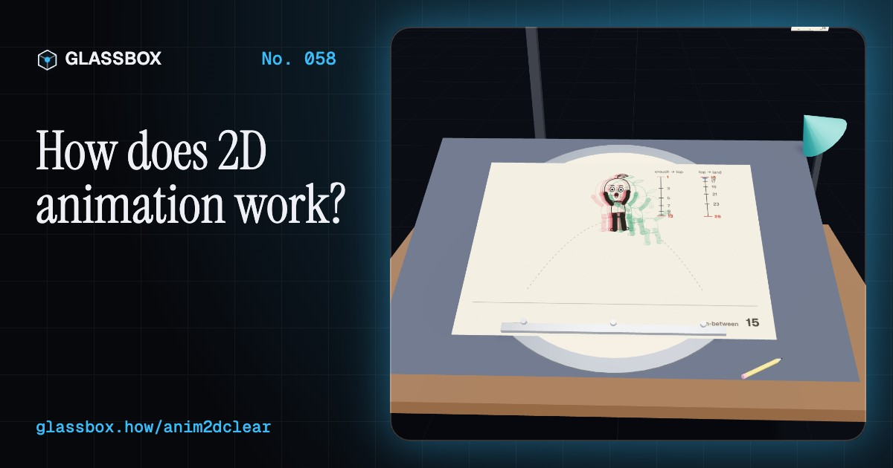
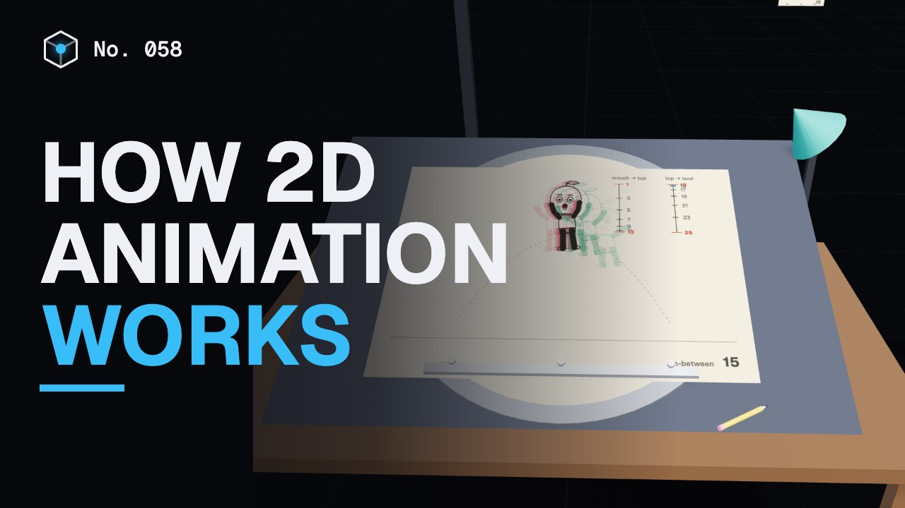
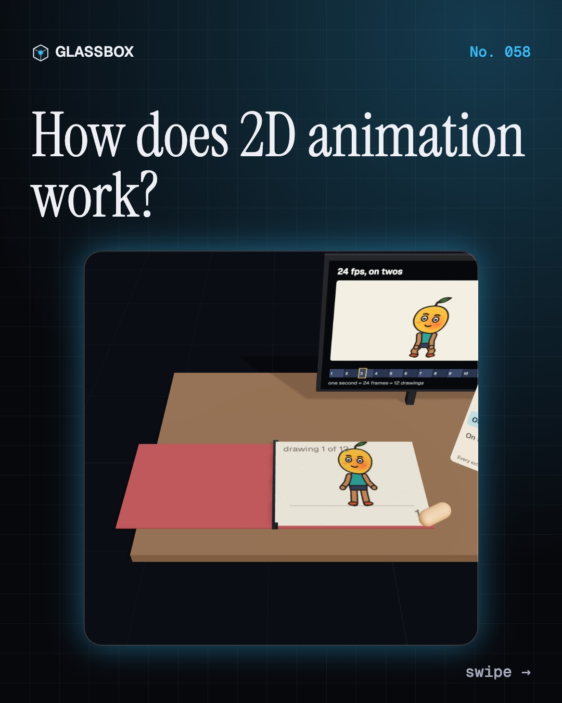
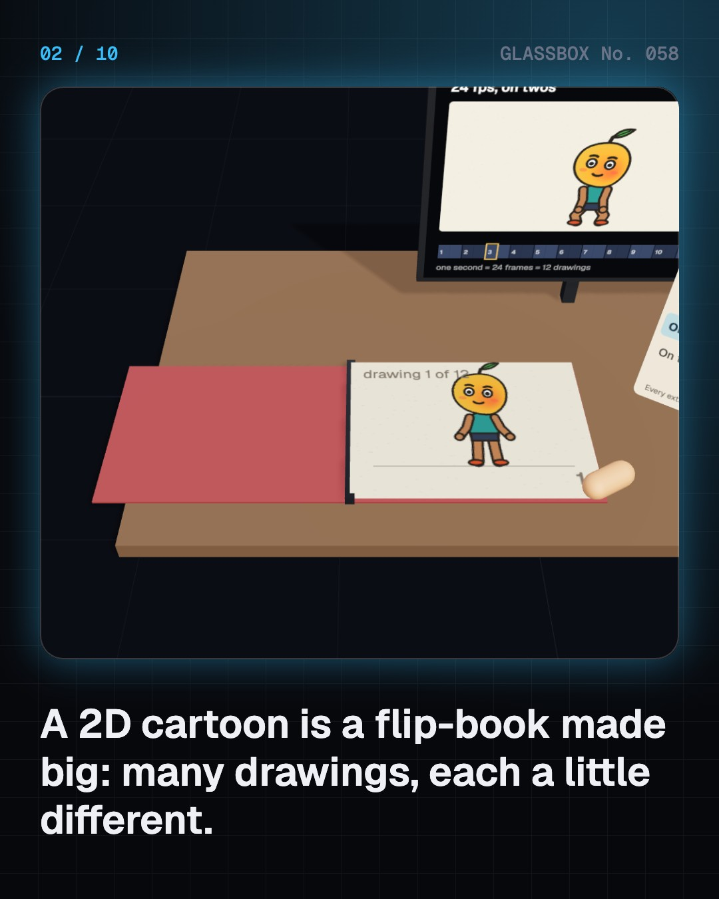
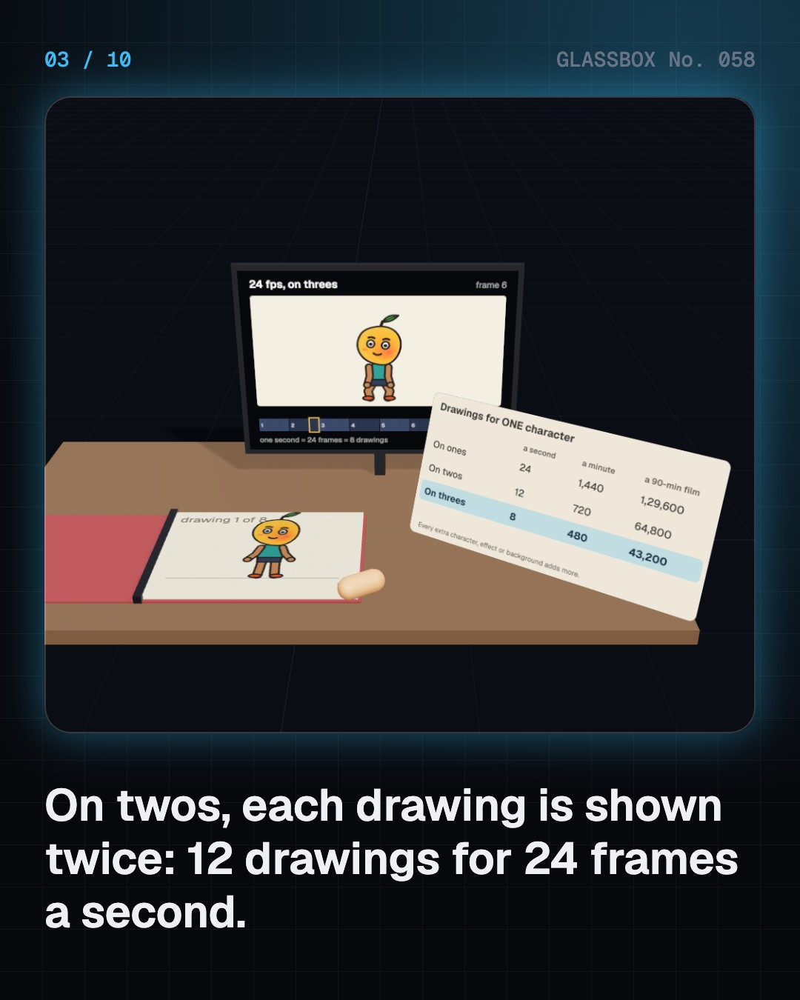
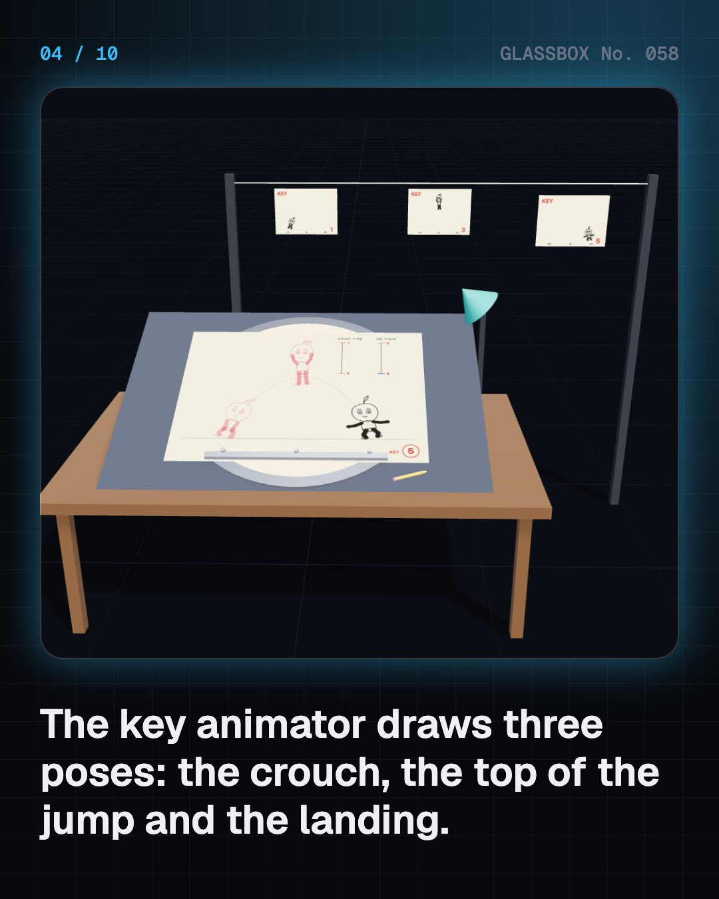

<!-- glassbox:start -->
<!-- Generated from glassbox.json by the Glassbox hub (npm run readme -- anim2dclear). Edit glassbox.json, not this block. -->
<p align="center"><a href="https://glassbox.how/e/anim2dclear/"></a></p>

<h1 align="center">Anim2DClear</h1>

<p align="center"><b>How does 2D animation work?</b><br>Every cartoon is a pile of drawings. Flip a flip-book, fill in a jump between key poses, switch the 12 principles on and off on a bouncing ball, spread cels out under a multiplane camera, and make a mango-headed kid talk.</p>

<p align="center"><a href="https://glassbox.how/anim2dclear/"><b>▶ Play with it</b></a> &nbsp;·&nbsp; <a href="https://glassbox.how/e/anim2dclear/">Read the 60-second explainer</a> &nbsp;·&nbsp; <a href="https://glassbox.how/anim2dclear/glassbox/reel.mp4">Watch the 40-second video</a></p>

<p align="center">
  <a href="https://glassbox.how/e/anim2dclear/"></a>
  <a href="https://glassbox.how/e/anim2dclear/"></a>
  <a href="LICENSE"></a>
  <a href="LICENSE-CONTENT.md"></a>
  <a href="#privacy"></a>
</p>

## In 60 seconds

1. **A flip-book made big.** A cartoon is thousands of still drawings, each a little different, shown one after another. Cinema shows 24 frames a second; most hand-drawn animation holds each drawing for two frames, “on twos”, so one character needs 12 drawings a second, 720 a minute.
2. **Keys first, in-betweens after.** The key animator draws the poses that tell the story. An in-betweener fills the gaps, following a timing chart whose ticks bunch near a key where the move slows in or out. A light table, or onion skinning in software, shows the drawings before and after.
3. **Twelve principles.** Frank Thomas and Ollie Johnston’s The Illusion of Life (1981) lists the 12 principles: squash and stretch, anticipation, staging, straight ahead and pose to pose, follow-through, slow in and out, arcs, secondary action, timing, exaggeration, solid drawing and appeal. A bouncing ball shows most of them, and its timing shows its weight.
4. **Cels, backgrounds and depth.** From 1914, moving characters were inked and painted on clear cels over one painted background. Disney’s multiplane camera (1937) spread the art over levels of glass, so near levels slide faster than far ones when the camera moves: parallax. A model sheet keeps every artist’s drawings on model.
5. **Rigs, tweens and curves.** On a computer, you can still draw every frame, or build a cut-out rig of pieces on pivots. You key the poses on a timeline and the computer tweens the in-betweens, spaced by an easing curve: straight is robotic, an S-curve eases in and out.
6. **Making drawings talk.** The voice is recorded first and read frame by frame onto an exposure sheet. Each frame gets a mouth shape from a small chart, often a frame or two ahead of the sound. Acting, a head tilt, raised brows or a blink, is what makes it feel alive.

## Words worth knowing

| Term | Meaning |
|---|---|
| **Frame** | One still picture in a film; cinema shows 24 a second. |
| **On twos** | Each drawing held for two frames: 12 drawings a second. |
| **Key pose** | A main drawing that shows an important moment of an action. |
| **In-between** | A drawing that fills the gap between two keys. |
| **Onion skin** | Faint ghosts of the drawings before and after the one you are drawing. |
| **Squash and stretch** | Flattening on impact and stretching in fast motion, keeping the same volume. |
| **Cel** | A clear sheet with the character inked on the front and painted on the back. |
| **Multiplane camera** | Artwork on levels at different distances from the camera, for parallax and depth. |
| **Tween** | In-betweens calculated by the computer between two keyframes. |
| **Exposure sheet** | A chart with one row per frame, listing sounds, actions and drawings. |

## A short history

**190 years from a spinning paper disc to hand-drawn films lit like 3D.**

- **1892** · Drawn films on a big screen (Émile Reynaud, Musée Grévin, Paris)
- **1914** · Gertie the Dinosaur (Winsor McCay, Palace Theater, Chicago)
- **1914** · The cel is patented (Earl Hurd (with John R. Bray), New York)
- **1937** · The multiplane camera (William Garity and Disney’s camera department, Burbank, California)
- **1937** · Snow White (Walt Disney Productions, Carthay Circle Theatre, Los Angeles)
- **1972** · The father of Indian animation (Ram Mohan, Mumbai)
- **1981** · The Illusion of Life (Frank Thomas and Ollie Johnston, New York (Abbeville Press))
- **1985** · Studio Ghibli is founded (Hayao Miyazaki, Isao Takahata, Toshio Suzuki and Yasuyoshi Tokuma, Koganei, Tokyo)

The full story, with 27 moments, charts, people and 37 sources: [glassbox.how/e/anim2dclear/history](https://glassbox.how/e/anim2dclear/history/). The data lives in [`history.json`](history.json).

## Video and slides

Made with the Glassbox studio from this box's storyboard (`window.glassbox.director`). Free to reuse under CC BY 4.0.

<a href="https://glassbox.how/anim2dclear/glassbox/video.mp4"></a>

<p><a href="glassbox/slide-1.jpg"></a> <a href="glassbox/slide-2.jpg"></a> <a href="glassbox/slide-3.jpg"></a> <a href="glassbox/slide-4.jpg"></a></p>

| File | What | Size |
|---|---|---|
| [`glassbox/reel.mp4`](https://glassbox.how/anim2dclear/glassbox/reel.mp4) | Reel / Short, with captions and soundtrack | 1080×1920 |
| [`glassbox/video.mp4`](https://glassbox.how/anim2dclear/glassbox/video.mp4) | YouTube video, with captions and soundtrack | 1920×1080 |
| `glassbox/slide-1…10.jpg` | Instagram carousel | 1080×1350 |
| `glassbox/thumb.jpg` | YouTube thumbnail | 1280×720 |
| `glassbox/cover.jpg` | Share card and repo social preview | 1200×630 |
| [`glassbox/history-reel.mp4`](https://glassbox.how/anim2dclear/glassbox/history-reel.mp4) | “History in 10 moments” Reel / Short | 1080×1920 |
| `glassbox/history-slide-*.jpg` | History carousel | 1080×1350 |
| `glassbox/post.json` | Post copy and schedule used by the publish kit | |

## Privacy

This box has no accounts and no ads, and it ships its own fonts and libraries. When you run it yourself it sends nothing anywhere. On glassbox.how, the site's `/bar.js` also loads Glassbox's analytics: **Google Analytics** to count visits (it asks first in the EU, UK and Switzerland, and stays off when your browser sends Global Privacy Control or Do Not Track) and **ClickTrust** to detect bots.

It remembers a few things **in your own browser only**, and never sends them anywhere:

| Browser storage key | What it holds |
|---|---|
| `anim2dclear.v1` | Which chapters you have opened, your best quiz scores, and sound on or off. |

Exactly what each one sees is at [glassbox.how/privacy](https://glassbox.how/privacy/).

## Licences

- **Code:** [MIT](LICENSE). Use it, change it, ship it.
- **Explanations, text, images and videos** (`glassbox.json`, `glassbox/`): [CC BY 4.0](LICENSE-CONTENT.md). Credit “Glassbox, glassbox.how/e/anim2dclear”.
- **Third-party parts** keep their own licences: [three.js](https://threejs.org) (MIT), [Geist, Instrument Serif](https://openfontlicense.org) (SIL OFL 1.1).
- The Glassbox name and logo aren't covered by either licence. See the [terms](https://glassbox.how/terms/).

Found a mistake? [Open an issue](https://github.com/bdeeps/anim2dclear/issues). Corrections happen in public.
<!-- glassbox:end -->

## Run it

It's plain HTML, CSS and JavaScript. No build step and no dependencies. Run locally, it contacts no other website.

```bash
python3 -m http.server 8000
```

Three.js and the fonts ship in `vendor/` and `fonts/`, so it also works offline.

Then open http://localhost:8000.

## How it's built

| File | What |
|---|---|
| `index.html`, `css/app.css` | The page and its styles |
| `js/app.js`, `js/stage.js`, `js/ui.js`, `js/kit.js` | The shared Glassbox 3D engine: chapters, 3D stage, controls, quiz, video director |
| `js/chapters/*.js` | One file per chapter: the 3D model, controls, text, key terms, quiz and video scenes |
| `js/anim.js` | Shared drawing and timing code: Aamu the mango kid, the bouncing ball, mouth shapes, easing curves, canvas boards and the Web Audio formant voice |
| `glassbox.json` | Title, question, explainer beats, key terms, browser storage and credits shown on glassbox.how |
| `reel` in each chapter | The storyboard the Glassbox studio records into short videos |
| `glassbox/` | The published video, slides, thumbnail and post copy |
| `fonts/`, `vendor/three/` | Self-hosted Geist and Instrument Serif (SIL OFL 1.1) and three.js (MIT) |
